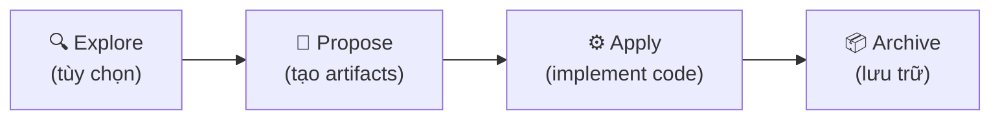

# Hướng Dẫn Sử Dụng OpenSpec

> **OpenSpec** là công cụ Spec-Driven Development giúp quản lý thay đổi code theo quy trình: **Propose → Apply → Archive**.

---

## 1. Tổng Quan

### OpenSpec là gì?

OpenSpec giúp bạn:
- **Lên kế hoạch** trước khi code (proposal, design, specs)
- **Chia nhỏ** công việc thành tasks có thể track
- **Đảm bảo chất lượng** qua specs có thể test
- **Lưu trữ** lịch sử thay đổi

### Khi nào dùng OpenSpec?

| Dùng OpenSpec ✅ | KHÔNG dùng ❌ |
|---|---|
| Thêm feature mới (API, service) | Fix bug đơn giản |
| Thay đổi schema database | Refactor nhỏ (rename, move code) |
| Tích hợp hệ thống bên ngoài | Cập nhật config |
| Thay đổi ảnh hưởng nhiều file | Sửa typo, comment |

### Cấu trúc thư mục

```
openspec/
├── config.yaml              # Cấu hình project
├── specs/                   # Specs hiện có (knowledge base)
│   ├── api/                 # API specs
│   ├── database/            # Database specs
│   └── integration/         # Integration specs
└── changes/                 # Các thay đổi đang làm
    ├── <change-name>/       # Mỗi change 1 folder
    │   ├── proposal.md      # Đề xuất (Why + What)
    │   ├── design.md        # Thiết kế (How)
    │   ├── specs/           # Delta specs (requirements)
    │   └── tasks.md         # Checklist công việc
    └── archive/             # Các change đã hoàn thành
```

---

## 2. Workflow Chính

### Flow tổng quát

```
/opsx-propose → /opsx-apply → /opsx-archive
```



### Bước 1: Explore (tùy chọn)

> Dùng khi cần khảo sát codebase trước khi đề xuất.

```
/opsx-explore
```

Mô tả vấn đề hoặc ý tưởng, AI sẽ giúp:
- Phân tích codebase liên quan
- Đánh giá khả thi
- Đề xuất hướng tiếp cận

### Bước 2: Propose

> Tạo đề xuất thay đổi với đầy đủ artifacts.

```
/opsx-propose
```

**Quy trình:**
1. Mô tả feature cần làm
2. AI sẽ tạo lần lượt 4 artifacts:

| Thứ tự | Artifact | Nội dung |
|--------|----------|----------|
| 1 | `proposal.md` | **Why** + **What** — Lý do và phạm vi thay đổi |
| 2 | `design.md` | **How** — Quyết định kỹ thuật, trade-offs |
| 3 | `specs/*.md` | **Requirements** — Yêu cầu + scenarios có thể test |
| 4 | `tasks.md` | **Checklist** — Danh sách tasks dạng `- [ ]` |

**Kiểm tra trạng thái:**
```bash
openspec status --change "<change-name>"
```

### Bước 3: Apply

> Implement code theo tasks đã define.

```
/opsx-apply
```

**Quy trình:**
1. AI đọc `tasks.md` và implement từng task
2. Mỗi task hoàn thành → đánh dấu `- [x]` trong `tasks.md`
3. Code được tạo theo đúng conventions của project

### Bước 4: Archive

> Lưu trữ change sau khi hoàn thành.

```
/opsx-archive
```

**Quy trình:**
1. Verify tất cả tasks đã `[x]`
2. Merge specs vào `openspec/specs/` (knowledge base)
3. Move change folder vào `openspec/changes/archive/`

---

## 3. Ví Dụ Thực Tế

### Ví dụ: Thêm API thống kê yêu cầu

**Bước 1 — Propose:**
```
/opsx-propose
> Thêm API endpoint thống kê yêu cầu theo trạng thái, 
> hỗ trợ filter theo đơn vị và khoảng thời gian
```

AI sẽ tạo change `add-yeucau-stats` với:
- `proposal.md` — mô tả lý do cần API thống kê
- `design.md` — quyết định dùng POST, JOOQ GROUP BY
- `specs/yeucau-stats/spec.md` — 4 scenarios test
- `tasks.md` — 6 tasks (DTO, Repository, Service, Controller, Q_FUNCTION)

**Bước 2 — Apply:**
```
/opsx-apply
```

AI implement 6 tasks:
1. ✅ `YeuCauThongKeDTO.java`
2. ✅ `YeuCauThongKeFilterDTO.java`
3. ✅ `HsYeuCauRepository.thongKeByTrangThai()`
4. ✅ `YeuCauService.getThongKeByTrangThai()`
5. ✅ `TMSController POST /yeucau/thongke-trangthai`
6. ✅ `q_function.sql`

**Bước 3 — Archive:**
```
/opsx-archive
```

---

## 4. Các Lệnh CLI

| Lệnh | Mô tả |
|-------|--------|
| `openspec status` | Xem tất cả changes đang active |
| `openspec status --change "<name>"` | Xem trạng thái 1 change |
| `openspec new change "<name>"` | Tạo folder change mới |
| `openspec instructions <artifact> --change "<name>"` | Xem hướng dẫn tạo artifact |
| `openspec instructions <artifact> --change "<name>" --json` | Lấy hướng dẫn dạng JSON |

**Artifacts hợp lệ:** `proposal`, `design`, `specs`, `tasks`

---

## 5. Quy Tắc Viết Specs

### Format requirements

Mỗi requirement phải có:
- Heading `### Requirement: <tên>`
- Mô tả dùng **SHALL/MUST** (bắt buộc)
- Ít nhất 1 scenario

### Format scenarios

```markdown
#### Scenario: <tên scenario>
- **WHEN** <điều kiện>
- **THEN** <kết quả mong đợi>
```

### Delta operations

Khi thay đổi specs hiện có, dùng các section:
- `## ADDED Requirements` — Capability mới
- `## MODIFIED Requirements` — Thay đổi behavior (phải copy TOÀN BỘ requirement gốc)
- `## REMOVED Requirements` — Xóa feature (phải có **Reason** + **Migration**)

---

## 6. Quy Tắc Viết Tasks

```markdown
## 1. Tên nhóm task

- [ ] 1.1 Mô tả task cụ thể
- [ ] 1.2 Mô tả task cụ thể

## 2. Tên nhóm task khác

- [ ] 2.1 Mô tả task cụ thể
```

**Lưu ý:**
- Mỗi task PHẢI là checkbox `- [ ]`
- Tasks sắp xếp theo dependency (cái nào làm trước thì để trước)
- Mỗi task phải đủ nhỏ để hoàn thành trong 1 session
- Đánh dấu `- [x]` khi hoàn thành

---

## 7. Tích Hợp Với Quy Trình Hiện Tại

### OpenSpec + Agent Workflows

| Loại thay đổi | Dùng gì |
|---|---|
| Feature mới, nhiều file | `/opsx-propose` → `/opsx-apply` |
| CRUD đơn giản cho 1 entity | `/generate-crud-api` |
| Thêm 1 endpoint vào controller có sẵn | `/add-api-endpoint` |
| Fix lỗi nhanh | `/quick-fix` |

### Git Policy

- Mỗi OpenSpec change = 1 branch: `feature/opsx-<change-name>`
- Commit message prefix: `[opsx] <message>`
- Archive change trước khi merge

---

## 8. Custom Schemas (TMS Project)

Trong `openspec/config.yaml`, project TMS định nghĩa 3 loại change:

| Schema | Khi nào dùng | Artifacts |
|--------|-------------|-----------|
| `api-change` | Thêm/sửa REST API | proposal, design, api-spec, tasks |
| `db-migration` | Thay đổi database schema | proposal, migration-spec, rollback-plan, tasks |
| `integration` | Tích hợp hệ thống ngoài | proposal, design, integration-spec, tasks |

---

## 9. Troubleshooting

### Change không hiện trong status

```bash
# Kiểm tra folder có tồn tại
ls openspec/changes/<change-name>/

# Phải có ít nhất 1 artifact file
```

### Tasks không được track

- Đảm bảo dùng format `- [ ]` (có khoảng trắng giữa `[` và `]`)
- KHÔNG dùng bullet points hoặc numbered list thông thường

### Muốn hủy change

Xóa folder change:
```bash
rm -rf openspec/changes/<change-name>/
```

---

## 10. Tóm Tắt Quick Reference

```
┌─────────────────────────────────────────────┐
│  OpenSpec Quick Reference                    │
├─────────────────────────────────────────────┤
│                                             │
│  🔍 Khảo sát:    /opsx-explore              │
│  📝 Đề xuất:     /opsx-propose              │
│  ⚙️ Implement:   /opsx-apply                │
│  📦 Lưu trữ:     /opsx-archive              │
│                                             │
│  📊 Xem status:  openspec status             │
│                                             │
│  Artifacts:  proposal → design → specs → tasks│
│                                             │
└─────────────────────────────────────────────┘
```
