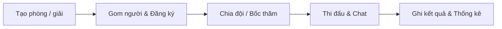
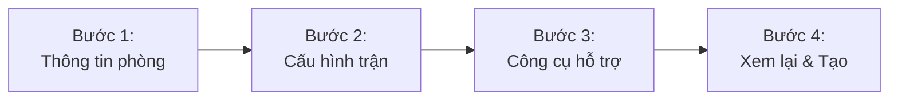
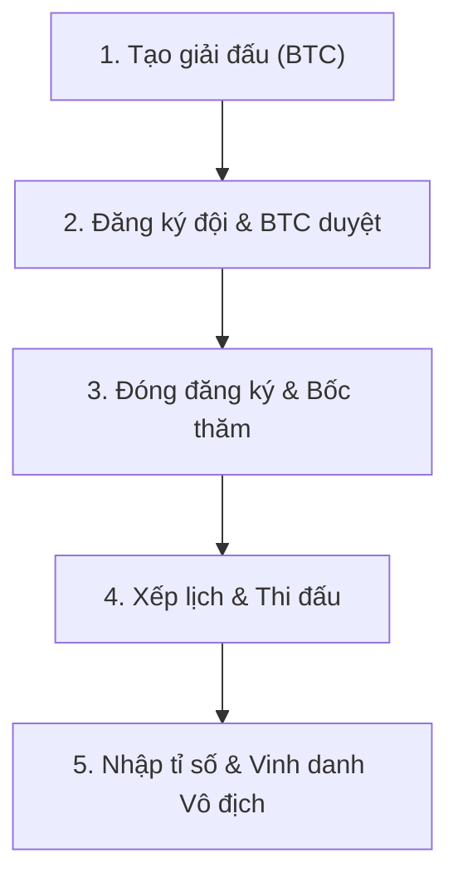

# Hướng Dẫn Sử Dụng customAOV

> **customAOV** là nền tảng web hỗ trợ người chơi Liên Quân Mobile (AOV) tổ chức các trận đấu **custom 5v5** và **giải đấu cộng đồng**: tạo phòng, chia đội tự động công bằng, trò chuyện thời gian thực, bốc thăm nhánh đấu và quản lý kết quả minh bạch.

---

## Mục Lục

1. [Tổng Quan](#1-tổng-quan)
   - [Giới thiệu](#giới-thiệu)
   - [Hai chế độ hoạt động (Mock & API)](#hai-chế-độ-hoạt-động-mock--api)
   - [Vai trò người dùng](#vai-trò-người-dùng)
2. [Quản Lý Tài Khoản](#2-quản-lý-tài-khoản)
   - [Đăng ký tài khoản](#đăng-ký-tài-khoản)
   - [Đăng nhập và đăng xuất](#đăng-nhập-và-đăng-xuất)
   - [Khôi phục phiên và bảo mật](#khôi-phục-phiên-và-bảo-mật)
3. [Phòng Custom 5v5](#3-phòng-custom-5v5)
   - [Tạo phòng mới (Wizard 4 bước)](#tạo-phòng-mới-wizard-4-bước)
   - [Vào phòng và tham gia](#vào-phòng-và-tham-gia)
   - [Chọn vị trí (Lane) và sẵn sàng](#chọn-vị-trí-lane-và-sẵn-sàng)
   - [Chia đội cân bằng](#chia-đội-cân-bằng)
   - [Đổi chỗ và quản lý thành viên](#đổi-chỗ-và-quản-lý-thành-viên)
   - [Mời ra khỏi phòng](#mời-ra-khỏi-phòng)
   - [Trò chuyện thời gian thực (Chat phòng)](#trò-chuyện-thời-gian-thực-chat-phòng)
   - [Xuất kết quả chia đội](#xuất-kết-quả-chia-đội)
   - [Ghi nhận kết quả trận đấu](#ghi-nhận-kết-quả-trận-đấu)
4. [Giải Đấu Cộng Đồng](#4-giải-đấu-cộng-đồng)
   - [Xem danh sách giải đấu](#xem-danh-sách-giải-đấu)
   - [Tạo giải đấu mới (Wizard 4 bước)](#tạo-giải-đấu-mới-wizard-4-bước)
   - [Đăng ký đội tham gia](#đăng-ký-đội-tham-gia)
   - [Ban tổ chức duyệt đăng ký](#ban-tổ-chức-duyệt-đăng-ký)
   - [Đóng đăng ký giải đấu](#đóng-đăng-ký-giải-đấu)
   - [Bốc thăm nhánh đấu](#bốc-thăm-nhánh-đấu)
   - [Xếp lịch thi đấu](#xếp-lịch-thi-đấu)
   - [Nhập tỉ số và cập nhật nhánh](#nhập-tỉ-số-và-cập-nhật-nhánh)
   - [Theo dõi 5 tab chi tiết giải](#theo-dõi-5-tab-chi-tiết-giải)
5. [Hồ Sơ Người Chơi](#5-hồ-sơ-người-chơi)
   - [Xem thông tin hồ sơ](#xem-thông-tin-hồ-sơ)
   - [Chỉnh sửa hồ sơ cá nhân](#chỉnh-sửa-hồ-sơ-cá-nhân)
   - [Thống kê và thành tích](#thống-kê-và-thành-tích)
6. [Tìm Kiếm & Hoạt Động](#6-tìm-kiếm--hoạt-động)
   - [Hộp tìm kiếm nhanh (Ctrl+K)](#hộp-tìm-kiếm-nhanh-ctrlk)
   - [Dòng hoạt động gần đây & Trang /activities](#dòng-hoạt-động-gần-đây--trang-activities)

---

## 1. Tổng Quan

### Giới thiệu

customAOV giải quyết các vấn đề thường gặp khi tổ chức kèo custom hay giải mini qua mạng xã hội: gom người thủ công, chia đội thiếu cân bằng, chép kết quả rời rạc trên bảng tính hoặc tin nhắn.



### Hai chế độ hoạt động (Mock & API)

Ứng dụng hỗ trợ hai chế độ thông qua cấu hình môi trường:

| Chế độ | Mục đích | Đặc điểm |
|---|---|---|
| **API** (`VITE_DATA_SOURCE=api`) | Chế độ chạy đầy đủ tính năng | Dữ liệu lưu tại máy chủ backend qua CSDL, hỗ trợ đăng ký/đăng nhập thật, cập nhật thời gian thực qua WebSocket. |
| **Mock** (`VITE_DATA_SOURCE=mock`) | Môi trường thử nghiệm giao diện | Dùng dữ liệu mẫu cố định, có sẵn tài khoản thử nghiệm `suthy`, thao tác lưu trữ tại bộ nhớ trình duyệt. |

### Vai trò người dùng

| Vai trò | Phạm vi thao tác chính |
|---|---|
| **Khách (Chưa đăng nhập)** | Xem trang chủ giới thiệu, xem danh sách giải đấu công khai, tra cứu thông tin cơ bản. |
| **Người dùng (Đã đăng nhập)** | Tạo phòng, vào phòng, đăng ký đội tham gia giải, trò chuyện, chỉnh sửa hồ sơ. |
| **Chủ phòng (Host)** | Chia lại đội, đổi chỗ người chơi, mời ra khỏi phòng, random lane, ghi nhận tỉ số trận đấu. |
| **Ban tổ chức giải (BTC)** | Quản lý giải do mình tạo: duyệt đội đăng ký, đóng đăng ký, bốc thăm nhánh đấu, xếp lịch và nhập tỉ số. |

---

## 2. Quản Lý Tài Khoản

### Đăng ký tài khoản

1. Bấm nút **Đăng nhập** trên thanh điều hướng trên cùng (TopNav).
2. Chuyển sang thẻ **Đăng ký** trên hộp thoại.
3. Nhập đầy đủ thông tin:
   - **Tên đăng nhập (`username`):** 3–20 ký tự, chỉ gồm chữ thường (`a-z`), số (`0-9`) và dấu gạch dưới (`_`).
   - **Tên hiển thị (`displayName`):** 1–24 ký tự (tên sẽ hiển thị trong phòng và giải đấu).
   - **Mật khẩu (`password`):** 8–72 ký tự.
4. Bấm **Tạo tài khoản**. Sau khi đăng ký thành công, hệ thống tự động đăng nhập và đưa bạn về trang Tổng quan (Dashboard).

### Đăng nhập và đăng xuất

- **Đăng nhập:** Mở hộp thoại đăng nhập, nhập tên đăng nhập và mật khẩu, rồi bấm **Đăng nhập**.
  > **Mẹo (ở chế độ Mock):** Bạn có thể bấm vào thẻ **Tài khoản mẫu (suthy)** để truy cập nhanh mà không cần nhập mật khẩu.
- **Đăng xuất:** Bấm vào hình đại diện của bạn ở góc phải TopNav -> chọn **Đăng xuất**.

### Khôi phục phiên và bảo mật

- Phiên đăng nhập được quản lý bằng cookie bảo mật `httpOnly` với thuộc tính `SameSite=Lax`.
- Mọi thao tác ghi dữ liệu đều được bảo vệ bởi cơ chế phòng chống tấn công CSRF (Double-submit token) và giới hạn tần suất gửi yêu cầu (Rate limiting).
- Khi bạn tải lại trang hoặc mở lại trình duyệt, phiên đăng nhập được khôi phục tự động.

---

## 3. Phòng Custom 5v5

### Tạo phòng mới (Wizard 4 bước)

Để tạo phòng mới, bấm nút **Tạo phòng** ở TopNav (hoặc nút **+** trên thanh điều hướng dưới ở thiết bị di động). Quy trình gồm 4 bước:



1. **Bước 1 – Thông tin phòng:**
   - **Tên phòng:** Tối đa 50 ký tự (ví dụ: *Kèo giao hữu tối thứ Bảy*).
   - **Mô tả phòng:** Ghi chú nội quy hoặc thể thức thi đấu (tối đa 200 ký tự).
   - **Chế độ chơi:** Đấu thường, Giải đấu, Giao hữu hoặc Khác.
   - **Quyền riêng tư:**
     - *Công khai:* Mọi người đều thấy trên danh sách phòng tại Dashboard.
     - *Riêng tư:* Chỉ người có mã phòng hoặc đường dẫn mời trực tiếp mới có thể vào.
   - **Khán giả:** Bật/tắt cho phép người ngoài vào xem (tối đa 20 khán giả).
2. **Bước 2 – Cấu hình trận:**
   - **Số người:** Hỗ trợ chuẩn **5 vs 5 (10 người chơi)**. *(Chế độ 3v3 và 1v1 hiện có nhãn Sắp có).*
   - **Luật cấm/chọn:** Cấm/chọn (Draft - cho phép chọn 0, 2, 3 hoặc 4 lượt cấm mỗi bên), Chọn ẩn (Blind) hoặc Ngẫu nhiên toàn bộ.
   - **Bản đồ:** Đấu trường 5v5 (3 đường) hoặc Hỗn chiến 1 đường.
   - **Thể thức:** BO1 (1 ván), BO3 (thắng 2 ván) hoặc BO5 (thắng 3 ván).
3. **Bước 3 – Công cụ hỗ trợ:**
   - Bật/tắt các công cụ trong phòng:
     - **Chia đội:** Chọn cách chia mặc định là *Ngẫu nhiên* hoặc *Cân bằng theo Tier*.
     - **Random lane:** Tự động chia vị trí đi đường ngẫu nhiên.
     - **Chat phòng:** Khung trao đổi tin nhắn trực tiếp giữa các thành viên.
     - *(Random tướng và Hộp bí ẩn là các công cụ giao diện hỗ trợ thêm).*
4. **Bước 4 – Xem lại & Tạo:**
   - Kiểm tra lại toàn bộ thông số đã cấu hình. Bấm **Sửa** tại từng nhóm nếu cần thay đổi.
   - Bấm nút **Tạo phòng**. Sau khi tạo, bạn sẽ được chuyển thẳng tới trang chi tiết phòng vừa tạo.

### Vào phòng và tham gia

Có 3 cách để vào phòng:
- **Từ danh sách phòng:** Tại trang chủ Dashboard hoặc mục Danh sách phòng, bấm nút **Vào phòng** (đối với phòng bạn là thành viên) hoặc **Tham gia** / **Xem**.
- **Qua đường dẫn mời:** Truy cập liên kết dạng `/rooms/AOV-1234` (đối với phòng riêng tư, liên kết sẽ kèm khóa mời dạng `?key=...`).
- **Tìm kiếm:** Gõ mã phòng hoặc tên phòng vào hộp tìm kiếm (`Ctrl+K`).

Khi vào phòng với tư cách người xem, bạn có thể bấm **Vào thi đấu** để đăng ký làm người chơi (nếu phòng còn chỗ trống) hoặc bấm **Vào xem** để theo dõi với vai trò Khán giả.

### Chọn vị trí (Lane) và sẵn sàng

Khi ở trong một đội (Team Xanh hoặc Team Đỏ):
1. **Chọn vị trí:** Bấm vào biểu tượng vị trí của bạn để chọn một trong 5 vai trò:
   - **TOP:** Đường trên (Đường Caesar)
   - **JG:** Đi rừng
   - **MID:** Đường giữa
   - **AD:** Xạ thủ (Đường Rồng)
   - **SP:** Trợ thủ
2. **Sẵn sàng:** Bấm nút **Sẵn sàng** (nút sẽ chuyển sang trạng thái đã sẵn sàng kèm màu nổi bật). Bạn có thể bấm lại để hủy trạng thái sẵn sàng khi cần đổi thông tin.

### Chia đội cân bằng

> **Chỉ Chủ phòng:** Chủ phòng có toàn quyền điều khiển tính năng chia đội.

- Bấm nút **Chia lại** ở đầu màn hình hoặc chọn công cụ **Chia đội cân bằng** ở tab **Công cụ**.
- Thuật toán tự động tính toán và hoán đổi vị trí giữa 10 người chơi của Team Xanh và Team Đỏ để tạo ra hai đội hình cân bằng nhất về chỉ số trình độ (Tier).
- Mọi người trong phòng sẽ thấy đội hình được cập nhật tức thì trên màn hình.

### Đổi chỗ và quản lý thành viên

Chủ phòng có thể sắp xếp lại vị trí linh hoạt:
- **Kéo thả:** Nhấp giữ chuột vào biểu tượng tay cầm kéo thả ở cạnh tên người chơi và thả sang vị trí mong muốn ở đội đối diện.
- **Menu tùy chọn:** Bấm nút menu **ba chấm (⋮)** bên cạnh tên người chơi:
  - Chọn **Chuyển sang Team Đỏ** / **Chuyển sang Team Xanh** để đổi bên thi đấu.
  - Chọn **Chuyển thành Khán giả** nếu muốn đưa người chơi về hàng chờ theo dõi.

### Mời ra khỏi phòng

Nếu có thành viên không đúng quy định hoặc rời trận:
1. Chủ phòng bấm nút menu **ba chấm (⋮)** tại dòng của người chơi đó.
2. Chọn **Mời ra khỏi phòng**.
3. Người chơi bị mời ra sẽ nhận được thông báo ngay lập tức và được điều hướng về trang Dashboard.

### Trò chuyện thời gian thực (Chat phòng)

- Khung chat nằm ở cột bên phải (trên màn hình máy tính) hoặc tab **Tin nhắn** (trên điện thoại).
- Cập nhật thời gian thực qua kênh WebSocket: bạn thấy tin nhắn của mọi người mà không cần tải lại trang.
- Nhập nội dung vào ô **Nhập tin nhắn...** và bấm phím **Enter** hoặc nút **Gửi**.
- *Lưu ý:* Khán giả chỉ có quyền xem tin nhắn; chỉ người chơi trong đội và chủ phòng mới có quyền gửi tin.

### Xuất kết quả chia đội

Để gửi đội hình cho cả nhóm xem trên Zalo hoặc Discord:
1. Bấm nút **Xuất kết quả** (hoặc biểu tượng sao chép).
2. Hệ thống định dạng sẵn danh sách chia đội dưới dạng văn bản và tự động lưu vào bộ nhớ tạm (Clipboard):
   ```text
   [customAOV] Kèo giao hữu tối thứ Bảy (AOV-1024)
   ---
   TEAM XANH:
   1. suthy (MID)
   2. BlackDragon (JG)
   ...
   TEAM ĐỎ:
   1. KillerQueen (TOP)
   2. ShadowHunter (AD)
   ...
   ```
3. Mở Zalo/Discord và dán (`Ctrl+V`) vào khung chat.

### Ghi nhận kết quả trận đấu

Sau khi trận đấu kết thúc:
1. Tại khu vực **Kết quả trận đấu** (chỉ hiển thị cho Chủ phòng khi phòng có đủ người):
2. Bấm nút **Team Xanh thắng** hoặc **Team Đỏ thắng**.
3. Phòng sẽ chuyển sang trạng thái **Đã kết thúc (`finished`)**.
4. Kết quả trận đấu sẽ tự động được ghi nhận vào lịch sử trận và cộng vào tỉ số Thắng/Thua trong **Hồ sơ** của tất cả người chơi tham gia.

---

## 4. Giải Đấu Cộng Đồng



### Xem danh sách giải đấu

- Truy cập trang **/tournaments** từ thanh menu.
- Bộ lọc theo trạng thái:
  - **Tất cả:** Toàn bộ các giải đấu trong hệ thống.
  - **Đang mở đăng ký:** Các giải còn chỉ tiêu nhận đội.
  - **Đang diễn ra:** Các giải đang thi đấu các vòng loại/bán kết/chung kết.
  - **Đã kết thúc:** Các giải đã hoàn tất và đã có nhà vô địch.
- Có thể tìm kiếm theo tên giải và chuyển trang qua thanh phân trang phía dưới.

### Tạo giải đấu mới (Wizard 4 bước)

Bấm nút **Tạo giải đấu** tại trang `/tournaments` để mở trình tạo giải `/tournaments/new`:

1. **Bước 1 – Thông tin:** Nhập tên giải đấu (tối đa 60 ký tự), điểm nhấn tiêu đề (Accent), mô tả ngắn gọn và chọn 1 trong 3 mẫu ảnh bìa nổi bật.
2. **Bước 2 – Thể thức:** Chọn quy mô số lượng đội (**4 đội**, **8 đội** hoặc **16 đội**) và thể thức các trận (**BO1**, **BO3** hoặc **BO5**).
3. **Bước 3 – Lịch thi đấu:** Cấu hình các mốc thời gian quan trọng:
   - Hạn chót đăng ký đội.
   - Thời điểm bốc thăm nhánh đấu.
   - Ngày bắt đầu và ngày kết thúc giải.
4. **Bước 4 – Luật & Giải thưởng:** Điền quy định điều lệ thi đấu và cơ cấu giải thưởng (Nhất, Nhì, Ba...).
5. Bấm **Tạo giải đấu** để hoàn tất. Bạn sẽ là **Ban tổ chức (BTC)** của giải này.

### Đăng ký đội tham gia

Khi một giải đấu đang ở trạng thái **Đang mở đăng ký (`open`)**:
1. Đội trưởng truy cập trang chi tiết giải đấu (`/tournaments/:slug`).
2. Bấm nút vàng **Đăng ký tham gia** trên banner giải đấu.
3. Trong hộp thoại đăng ký đội (`RegisterTeamDialog`):
   - **Tên đội:** Nhập tên đội đại diện thi đấu.
   - **Đội trưởng:** Tài khoản của bạn được mặc định làm đội trưởng (Thành viên 1).
   - **Thành viên chính:** Nhập tên đăng nhập (`username`) của 4 thành viên chính thức còn lại.
   - **Thành viên dự bị:** Có thể đăng ký thêm tối đa 2 thành viên dự bị (không bắt buộc).
4. Bấm **Gửi đăng ký**. Đơn đăng ký sẽ chuyển sang trạng thái chờ duyệt.

### Ban tổ chức duyệt đăng ký

Khi bạn là người tạo giải (BTC), bạn sẽ thấy **Bảng điều khiển ban tổ chức** xuất hiện trên trang chi tiết giải:
- Mở mục danh sách đăng ký đội chờ duyệt.
- Bấm **Duyệt** để chấp thuận đội tham gia chính thức vào giải đấu.
- Bấm **Từ chối** nếu thông tin đội không hợp lệ hoặc thiếu thành viên.
- Thanh tiến độ hiển thị số đội đã duyệt trên tổng số đội tối đa của giải (ví dụ: `8/8 đội`).

### Đóng đăng ký giải đấu

- Khi đã đủ số lượng đội được duyệt hoặc đã đến hạn chót đăng ký, BTC bấm nút **Đóng đăng ký** trong bảng điều khiển.
- Xác nhận thao tác đóng đăng ký trên hộp thoại cảnh báo. Sau khi đóng, các đội mới không thể gửi thêm đơn đăng ký.

### Bốc thăm nhánh đấu

- Sau khi đã đóng đăng ký và có đủ tối thiểu 2 đội:
- BTC bấm nút **Bốc thăm nhánh đấu**.
- Hệ thống sẽ ngẫu nhiên ghép cặp và tạo sơ đồ nhánh đấu loại trực tiếp (Single Elimination Bracket). Trong trường hợp số đội chưa đủ lũy thừa của 2, hệ thống tự động sắp xếp các suất miễn đấu (Bye).
- *Lưu ý:* Khi chưa có trận đấu nào có tỉ số, BTC vẫn có thể bấm **Bốc lại** nếu cần bốc thăm lại.

### Xếp lịch thi đấu

- Tại Bảng điều khiển ban tổ chức, mục các trận đấu sẵn sàng:
- BTC có thể chọn từng trận đấu và cập nhật ngày giờ thi đấu cụ thể cho cặp trận.
- Lịch thi đấu được hiển thị rõ ràng tại tab **Lịch thi đấu** để các đội tiện theo dõi.

### Nhập tỉ số và cập nhật nhánh

1. Khi một trận đấu kết thúc, BTC bấm vào cặp đấu đó trên Bảng đấu hoặc bấm **Nhập tỉ số** trong bảng điều khiển.
2. Hộp thoại nhập điểm hiển thị theo đúng thể thức của giải (ví dụ BO3: thắng tối đa 2 ván):
   - Nhập số ván thắng của Đội A và Đội B (ví dụ `2 - 1`).
   - Bấm **Lưu tỉ số**.
3. **Tự động hóa nhánh đấu:**
   - Đội chiến thắng sẽ tự động được đưa vào nhánh đấu của vòng kế tiếp.
   - Khi trận Chung kết có kết quả, giải đấu tự động chuyển sang trạng thái **Đã kết thúc (`finished`)**.
   - Nhà Vô địch được tôn vinh trang trọng trên banner giải đấu và được lưu vĩnh viễn vào lịch sử thành tích.

### Theo dõi 5 tab chi tiết giải

Trang chi tiết giải đấu cung cấp 5 góc nhìn toàn diện (hỗ trợ chuyển tab qua URL `?tab=`):
- **Thông tin (`info`):** Tổng quan, thể thức thi đấu, mốc thời gian, cơ cấu giải thưởng và điều lệ.
- **Danh sách đội (`teams`):** Danh sách các đội đã được duyệt kèm danh sách thành viên chi tiết.
- **Bảng đấu (`bracket`):** Sơ đồ nhánh thi đấu trực quan, có thể cuộn ngang mượt mà, hiển thị rõ tỉ số và đội thắng.
- **Lịch thi đấu (`schedule`):** Các trận sắp diễn ra được nhóm theo ngày giờ.
- **Kết quả (`results`):** Toàn bộ kết quả các trận đã thi đấu theo thứ tự thời gian.

---

## 5. Hồ Sơ Người Chơi

### Xem thông tin hồ sơ

- Truy cập hồ sơ cá nhân qua mục **Hồ sơ** ở menu tài khoản (hoặc đường dẫn `/profile`).
- Xem hồ sơ người khác bằng đường dẫn `/profile/:userId` (ví dụ `/profile/suthy`).
- Thông tin nhận diện bao gồm:
  - Ảnh đại diện (Avatar).
  - Tên hiển thị và mã định danh (`@username`).
  - UID người chơi.
  - Tiểu sử cá nhân.

### Chỉnh sửa hồ sơ cá nhân

> Bạn chỉ có thể chỉnh sửa hồ sơ của chính mình.

1. Tại trang `/profile`, bấm nút **Chỉnh sửa hồ sơ**.
2. Hộp thoại cho phép bạn cập nhật:
   - **Tên hiển thị:** 1–24 ký tự.
   - **Tiểu sử:** Giới thiệu ngắn về phong cách chơi, vị trí sở trường.
   - **Giới thiệu thêm:** Thông tin đội tuyển hoặc lời nhắn.
   - **Đường dẫn ảnh đại diện (URL):** Nhập liên kết ảnh hợp lệ (bắt đầu bằng `https://`).
3. Bấm **Lưu thay đổi** để áp dụng.

### Thống kê và thành tích

Hồ sơ người chơi được chia thành 4 tab:
- **Tổng quan:**
  - Thống kê customAOV: Số trận custom đã chơi, tỉ lệ thắng (%), số trận Thắng / Thua ghi nhận từ các trận custom đã hoàn tất.
  - Huy hiệu giải đấu: Cúp Vô địch, Á quân hoặc Top 4 đạt được.
- **Lịch sử trận:** Danh sách chi tiết các trận custom gần đây, kết quả Thắng/Thua và thời gian diễn ra.
- **Tướng ưa thích:** Khung trưng bày tướng. *(Trong bản MVP hiển thị thông báo chờ dữ liệu kết nối trực tiếp từ game).*
- **Thành tích:** Bảng vinh danh đầy đủ các danh hiệu và cúp giải đấu cộng đồng.

---

## 6. Tìm Kiếm & Hoạt Động

### Hộp tìm kiếm nhanh (Ctrl+K)

Hộp tìm kiếm toàn cục hỗ trợ tra cứu dữ liệu cực nhanh:
- **Cách mở:** Bấm vào biểu tượng kính lúp trên TopNav hoặc nhấn tổ hợp phím:
  - **`Ctrl + K`** (trên máy tính Windows / Linux)
  - **`Cmd + K`** (trên máy tính macOS)
- **Tính năng tìm kiếm:**
  - Hỗ trợ tìm kiếm tiếng Việt không dấu (ví dụ: gõ `ngu kiet` vẫn tìm thấy `Ngũ Kiệt Cup`).
  - Tự động phân loại kết quả thành 3 nhóm: **Phòng**, **Giải đấu** và **Người chơi**.
- **Điều hướng bằng bàn phím:**
  - Dùng mũi tên **`↑`** và **`↓`** để di chuyển chọn kết quả.
  - Nhấn phím **`Enter`** để chuyển ngay tới trang tương ứng.
  - Nhấn phím **`Esc`** để đóng hộp tìm kiếm.

### Dòng hoạt động gần đây & Trang /activities

- **Hoạt động gần đây trên Dashboard:** Hiển thị 5 sự kiện mới nhất liên quan đến bạn và cộng đồng (tham gia phòng, đăng ký giải đấu, kết quả trận custom, vô địch giải).
- **Trang Hoạt động đầy đủ (`/activities`):**
  - Xem toàn bộ dòng thời gian sự kiện của hệ thống.
  - Phân trang theo tham số `?page=`.
  - Giúp bạn dễ dàng theo dõi lại các trận đấu và sự kiện cộng đồng đã diễn ra.
