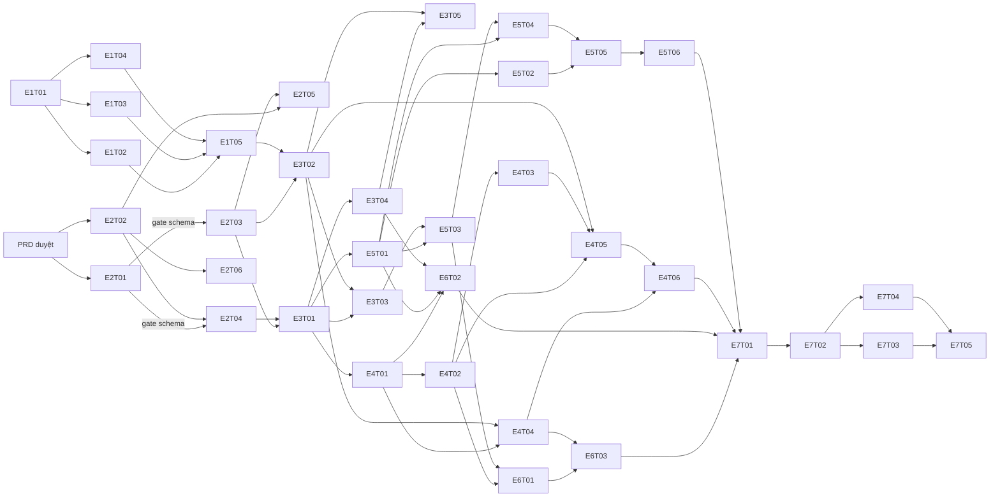

# ROADMAP – customAOV MVP

> Trạng thái: **ĐÃ DUYỆT 15/11/2026.** Lead được toàn quyền điều chỉnh task/model; mọi thay đổi ghi ở mục "Điều chỉnh" cuối file và trong `docs/orchestration/DECISIONS.md`. Thư viện thêm ngoài PRD mục 6 phải ghi lý do ở mục "Thư viện thêm".
> Chạy theo `docs/orchestration/ORCHESTRATION.md`: mỗi task có một `docs/orchestration/tasks/<id>.md`, nhánh `task/<id>-<slug>` rẽ từ `integration/mvp`, review khác hãng, task PASS thì merge vào `integration/mvp`, hết epic thì gate Owner merge vào `main`.

## Ký hiệu agent/model (bảng bậc ở ORCHESTRATION.md mục 3)

| Mã | Agent / model | Bậc | Hãng |
|---|---|---|---|
| **CX** | Codex `gpt-5.6-sol` medium (tắt priority) | B2 – coder chính | OpenAI |
| **HM** | Antigravity `gemini-4-hydrogen-medium` | B2-dài – audit, task dài, migration | Google |
| **FL** | Antigravity `gemini-3.8-flash-medium` | B1 – cơ học, docs, test đơn giản | Google |
| **CP** | Copilot `auto` (GPT-5.6 Luna) | B1 – task nhỏ, reviewer phụ | OpenAI |
| **SN** | Antigravity `claude-sonnet-5-5-medium` | B2 – khi cần model Claude, chia tải với CX | Anthropic |
| **OP** | Antigravity `claude-opus-5-5-medium` | B3 – task khó | Anthropic |
| **LD** | Lead (Claude `claude-opus-5-5`) | Kiến trúc | Anthropic |

Leo thang khi fail 2 lần: CX → SN → OP · HM → HH (`gemini-4-hydrogen-high`) → (B4) `gemini-4-argon-high` · FL/CP → CX · SN → OP. Hết quota: đổi sang model cùng bậc ở agent khác (CX ⇄ SN, HM ⇄ CX, FL ⇄ CP).

Ước lượng tính bằng **giờ agent** (thời gian worker chạy, chưa gồm review). Review thường mất khoảng 20–30% thời gian code.

---

## E1 – Rà soát 8 route và sửa P0 (frontend, chế độ mock)

Mục tiêu: frontend hiện tại sạch lỗi P0 trước khi nối API. **P0** = hỏng chức năng, lỗi console, cuộn ngang cấp trang, mất điều hướng bàn phím, vi phạm quy tắc cứng AGENTS.md (quá 1 nút vàng đặc trong một khung nhìn, tiêu đề/tab bị cắt `…`, token lẻ). **P1** = lệch thiết kế thấy được nhưng không chặn sử dụng. **P2** = gợi ý.

| ID | Việc | Coder | Reviewer | Phụ thuộc | Ước lượng |
|---|---|---|---|---|---|
| E1-T01 | **Audit chỉ đọc** 8 route × 375/768/1280/1440, đăng nhập suthy (trừ landing). Đối chiếu AGENTS.md, `UI_UX_CHECKLIST.md`, so với `docs/screenshots/baseline`. Đầu ra: danh sách P0/P1/P2 (route, khổ, bước tái hiện, file nghi ngờ). | HM | – (Lead phân loại) | – | 3 |
| E1-T02 | Sửa P0 nhóm `/`, `/dashboard`, `/tournaments` | CX | HM | E1-T01 | 2–3 |
| E1-T03 | Sửa P0 nhóm `/rooms/:roomId`, `/rooms/new` | CX | HM | E1-T01 | 2–3 |
| E1-T04 | Sửa P0 nhóm `/tournaments/:slug`, `/profile` | SN | CX | E1-T01 | 2–3 |
| E1-T05 | Hồi quy: screenshot so baseline, e2e, cập nhật `CHANGELOG-UI.md` và mục "Còn tồn" (P1/P2 chuyển thành backlog) | FL | CP | E1-T02..T04 | 1 |

Ghi chú: Lead tạo T02–T04 sau khi có kết quả T01. Nhóm nào không có P0 thì bỏ task đó. P1/P2 không sửa trong E1. **Gate: Owner merge E1 vào `main`.**

## E2 – Nền tảng backend và hợp đồng API

| ID | Việc | Coder | Reviewer | Phụ thuộc | Ước lượng |
|---|---|---|---|---|---|
| E2-T01 | **Thiết kế:** `docs/product/API.md` (endpoint, mã lỗi, sự kiện WebSocket), schema DB (Drizzle, bản nháp), quy ước phân quyền. **Gate schema DB.** | LD | CX | PRD duyệt | 4 |
| E2-T02 | Dựng `base-backend-api` (`package.json`, Fastify 5 + TS, config qua env, `/health`, log, Vitest + `inject`, `tsx` dev), thêm vào npm workspaces | CX | HM | PRD duyệt | 3 |
| E2-T03 | `packages/contracts`: schema zod + kiểu TS theo `API.md`, build và test | CX | HM | E2-T01 | 3 |
| E2-T04 | Tầng DB: schema Drizzle, migration trong `database/migrations/`, PGlite cho dev/test, `docker-compose.yml` Postgres tuỳ chọn, **seed từ mock hiện có** (8 giải, 5 phòng, suthy, …) để dữ liệu khớp UI | HM | CX | E2-T01 (gate), E2-T02 | 5 |
| E2-T05 | Lệnh gốc: `build`/`lint`/`test` bao cả backend và contracts; `npm run dev:api` và hướng dẫn chạy hai server | FL | CP | E2-T02, E2-T03 | 1 |
| E2-T06 | Viết lại `base-backend-api/AGENTS.md` và `.agent/rules` theo stack đã chọn (bỏ ví dụ Java/jOOQ) | FL | CX | E2-T02 | 1 |

**Gate: Owner merge E2 vào `main`.**

## E3 – Tài khoản và hồ sơ

| ID | Việc | Coder | Reviewer | Phụ thuộc | Ước lượng |
|---|---|---|---|---|---|
| E3-T01 | API auth: đăng ký/đăng nhập/đăng xuất/`me`, scrypt, bảng sessions, cookie httpOnly, rate limit | CX | HM | E2-T03, E2-T04 | 4 |
| E3-T02 | Tầng dữ liệu frontend `src/api/`: adapter `mock` (trả mock hiện tại, ảnh baseline không đổi) + adapter `http`; chọn bằng `VITE_DATA_SOURCE`; gắn `ListStatus` | CX | SN | E2-T03, E1 xong | 4 |
| E3-T03 | Nối auth: `LoginModal` có form đăng nhập/đăng ký thật (giữ nút tài khoản mẫu ở chế độ mock), `RequireAuth` theo `me`, đăng xuất; thêm `e2e-auth` cho chế độ api | SN | CX | E3-T01, E3-T02 | 4 |
| E3-T04 | API hồ sơ: xem theo id/`publicId`, sửa hồ sơ của mình, thống kê từ `room_matches` và thành tích giải | CX | HM | E3-T01 | 3 |
| E3-T05 | Nối `/profile`, `/profile/:userId`; hộp thoại sửa hồ sơ; empty state cho phần cần dữ liệu game | SN | CX | E3-T02, E3-T04 | 4 |

**Gate: Owner merge E3 vào `main`.**

## E4 – Phòng custom

| ID | Việc | Coder | Reviewer | Phụ thuộc | Ước lượng |
|---|---|---|---|---|---|
| E4-T01 | API phòng: danh sách (lọc, tìm không dấu, phân trang), tạo (cấu hình 4 bước), xem, vào/rời/xem, chọn lane, sẵn sàng, phòng riêng tư theo mã | CX | HM | E3-T01 | 5 |
| E4-T02 | API chủ phòng: chia đội ở server bằng `team-core` (`random`, `tier`), đổi chỗ, mời ra, random lane, xuất văn bản, ghi kết quả trận | CX | SN | E4-T01 | 4 |
| E4-T03 | Realtime: kênh WebSocket theo phòng, phát trạng thái, chat lưu DB + giới hạn, kết nối lại, xác thực bằng cookie | OP | CX | E4-T01, E4-T02 | 6 |
| E4-T04 | Nối dashboard `#rooms` và wizard `/rooms/new` | CX | HM | E4-T01, E3-T02 | 4 |
| E4-T05 | Nối `/rooms/:roomId` + hook realtime phía client; giữ 10 test `RoomDetail.test.tsx` (chỉ sửa selector nếu đổi nhãn) | SN | CX | E4-T02, E4-T03, E3-T02 | 6 |
| E4-T06 | E2E chế độ api: luồng 10 tài khoản vào phòng → chia đội → chat → ghi kết quả | HM | CX | E4-T04, E4-T05 | 3 |

**Gate: Owner merge E4 vào `main`.**

## E5 – Giải đấu

| ID | Việc | Coder | Reviewer | Phụ thuộc | Ước lượng |
|---|---|---|---|---|---|
| E5-T01 | API đọc giải: danh sách/lọc/chi tiết; chuyển logic suy ra từ `src/lib/tournament.ts` sang backend kèm test nhất quán | CX | HM | E3-T01 | 4 |
| E5-T02 | Tạo/sửa giải: API + trang `/tournaments/new` theo mẫu wizard của `/rooms/new` (nút "Tạo giải đấu" hết "Tính năng đang phát triển") | CX | SN | E5-T01 | 5 |
| E5-T03 | Đăng ký đội: API + hộp thoại đăng ký + BTC duyệt/từ chối; `RegistrationProgress` dùng dữ liệu thật | SN | CX | E5-T01, E3-T03 | 5 |
| E5-T04 | Engine nhánh đấu: bốc thăm (có bye), BO1/3/5, nhập tỉ số, đội thắng vào vòng sau, tự đổi trạng thái giải | OP | CX | E5-T01, E5-T03 | 6 |
| E5-T05 | Nối 5 tab `/tournaments/:slug` + thao tác BTC (đóng đăng ký, bốc thăm, nhập tỉ số) | CX | HM | E5-T02, E5-T04 | 5 |
| E5-T06 | E2E giải 8 đội: tạo → đăng ký → duyệt → bốc thăm → chung kết | HM | CX | E5-T05 | 3 |

**Gate: Owner merge E5 vào `main`.**

## E6 – Dashboard, tìm kiếm, hoạt động

| ID | Việc | Coder | Reviewer | Phụ thuộc | Ước lượng |
|---|---|---|---|---|---|
| E6-T01 | Ghi sự kiện (vào phòng, đăng ký giải, kết quả) + API feed + danh sách "xem thêm" | CX | HM | E4-T02, E5-T03 | 3 |
| E6-T02 | API tìm kiếm (phòng, giải, người dùng; không dấu) + nối `SearchDialog` | CP | HM | E4-T01, E5-T01, E3-T04 | 2 |
| E6-T03 | Nối dashboard: promo giải đang mở, "Phòng của bạn", "Hoạt động gần đây" | CX | SN | E6-T01, E4-T04 | 3 |

**Gate: Owner merge E6 vào `main`.**

## E7 – Hoàn thiện MVP

| ID | Việc | Coder | Reviewer | Phụ thuộc | Ước lượng |
|---|---|---|---|---|---|
| E7-T01 | Audit toàn MVP chỉ đọc: bảo mật (quyền, input, cookie), nhất quán dữ liệu, UX theo AGENTS.md, ở cả chế độ mock và api | HM (fail → HH) | – (Lead phân loại) | E6 xong | 4 |
| E7-T02 | Sửa P0 từ audit (Lead chia theo khu vực) | CX / SN | HM / CX | E7-T01 | 4 |
| E7-T03 | Chạy bộ test backend trên Postgres Docker; lệnh chạy cả app một bước; README | HM | CX | E7-T02 | 2 |
| E7-T04 | Tài liệu: README gốc, HDSD ngắn (chỉ mượn bố cục `docs/hdsd`), CHANGELOG | FL | CP | E7-T02 | 2 |
| E7-T05 | Hồi quy cuối: screenshot (mock + api) so baseline, e2e cả hai chế độ, kiểm tiêu chí PRD mục 8 | FL | CX | E7-T03, E7-T04 | 1 |

**Gate: Owner merge E7 vào `main` = MVP xong.**

---

## DAG và thứ tự chạy

Đợt chạy dự kiến (tối đa 3 worker cùng lúc; Lead làm E2-T01 song song với worker):

| Đợt | Chạy song song | Ghi chú |
|---|---|---|
| 1 | E1-T01 (HM) · E2-T02 (CX) · E2-T01 (LD) | Kết thúc đợt bằng **gate schema DB** |
| 2 | E1-T02/T03/T04 · E2-T03 · E2-T06 | E1 sửa frontend, E2 chỉ đụng backend/packages, nên không xung đột file |
| 3 | E1-T05 · E2-T04 · E2-T05 | Hết đợt: gate merge E1, E2 |
| 4 | E3-T01 · E3-T02 · E3-T04 | |
| 5 | E3-T03 · E3-T05 · E4-T01 | Gate merge E3 |
| 6 | E4-T02 · E5-T01 · E4-T04 | |
| 7 | E4-T03 · E5-T02 · E5-T03 | |
| 8 | E4-T05 · E5-T04 · E6-T02 | |
| 9 | E4-T06 · E5-T05 · E6-T01 | Gate merge E4 |
| 10 | E5-T06 · E6-T03 | Gate merge E5, E6 |
| 11 | E7-T01 → E7-T02 → E7-T03/T04 → E7-T05 | Gate merge E7 |

Tổng ước lượng khoảng **125 giờ agent** (chưa gồm review). Với 3 worker song song là khoảng 45–55 giờ chạy, tuỳ quota.

## Điểm dừng hỏi Owner trong roadmap

- **Gate schema DB** sau E2-T01 (và mọi migration sửa schema về sau).
- **Merge từng epic** `integration/mvp → main` (7 lần).
- Thư viện ngoài danh sách ở PRD mục 6, chi phí ngoài subscription, xoá dữ liệu, đổi phạm vi (vd. muốn đưa vòng bảng hay rank vào MVP).

> Từ 15/11: Owner trao toàn quyền. Các gate trên do Lead tự quyết và ghi vào DECISIONS.md, **trừ chi phí ngoài subscription** (cấm tuyệt đối).

## Điều chỉnh (Lead)

- 15/11 · Copilot bị giới hạn 20 lượt, chỉ dùng khi agent cùng bậc khác không khả dụng, nên CP được thay ở mọi chỗ trong bảng: reviewer của FL → **CX**; coder E6-T02 → **CX** (reviewer HM). CP chỉ còn là dự phòng cuối.
- 15/11 · E2-T01 không cần gate Owner (đã trao quyền). Lead làm xong thì cho chạy luôn E2-T03, E2-T04.
- 15/11 · E2-T06: thay hẳn nội dung template Java/jOOQ bằng quy tắc thật của stack (Owner yêu cầu), không chỉ gắn nhãn.

## Thư viện thêm (ngoài PRD mục 6)

| Ngày | Thư viện | Nơi dùng | Lý do |
|---|---|---|---|
